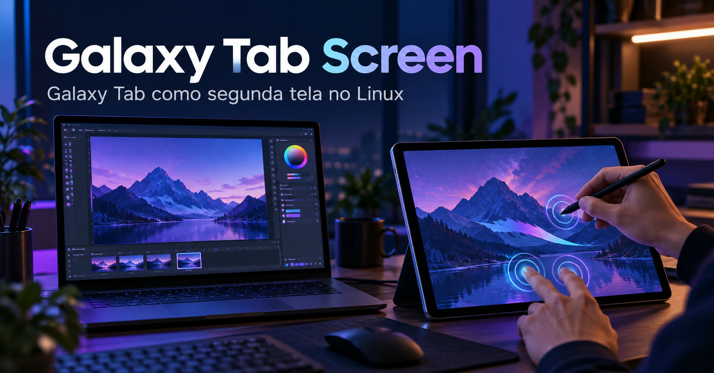

# Texto para o LinkedIn

Adaptei um Samsung Galaxy Tab S10 FE para funcionar como segunda tela no Linux. Testei extensão de tela, S Pen, touch e áudio por USB e Wi-Fi; no cabo, sem depuração USB.

Prévia com imagem para adicionar no LinkedIn: [abrir página](https://soteropolitano.github.io/galaxy-tab-screen-linux/linkedin-preview-v2/)
